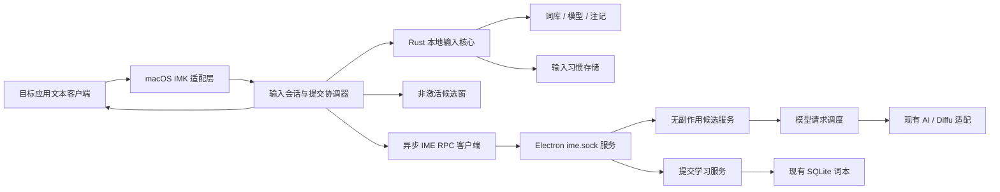
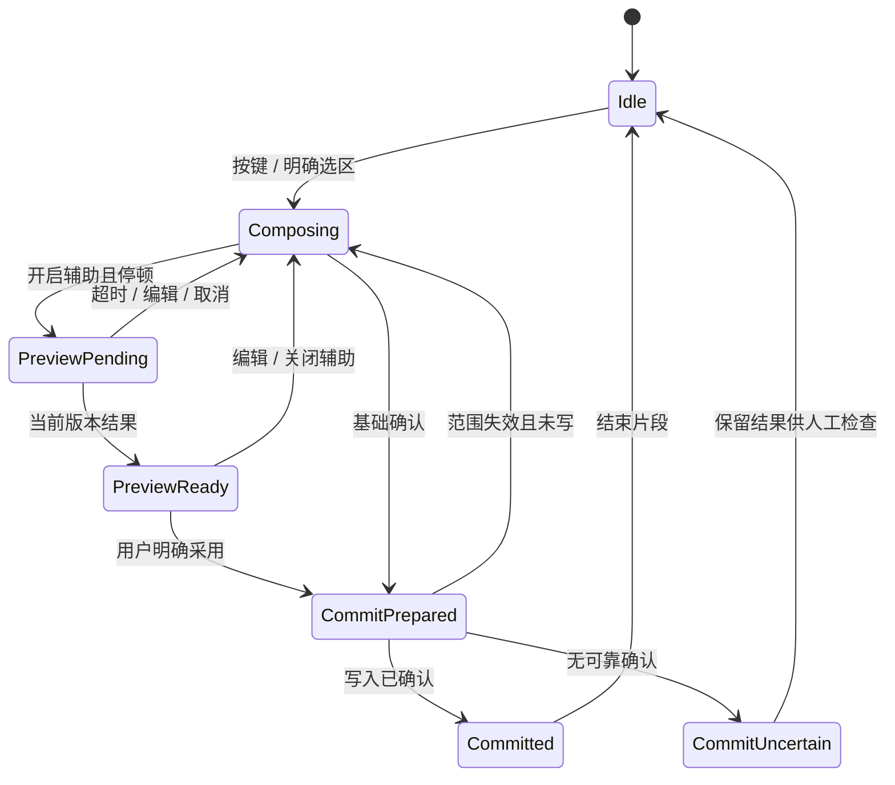

# v0.5.0 输入法架构设计

日期：2026-10-08 · 状态：目标设计，开发实现已开始；桌面标识仍为 0.4.5

依据：[输入法 PRD](../产品需求目录/PRD-v0.5.0-双语学习输入法.md)、[qingjian 基础对标](../产品需求目录/v0.5.0-qingjian基础能力对标.md)、[参考评估](v0.5.0-输入法参考评估.md)。本文定义目标架构，目录、接口和数据表均为拟新增，不能视为已经实现。

## 1. 设计约束与技术选择

基础能力覆盖 QJ-B01–B20，学习语言仅英语，输出仍支持中英两种。默认只替换活动词 / 短语；整句转换需要明确范围。基础输入不依赖 Electron、云服务或浏览器扩展，不能用剪贴板模拟系统输入法。

采用 Rust 平台无关核心 + macOS InputMethodKit 原生适配层，候选窗口采用非激活原生面板；Electron 继续承担统一模型配置、云请求和英语词本。qingjian 代码与数据具体复用方案在许可关卡确定后实施；其品牌不复用。技术边界不等于许可兼容结论。

三个原则：系统按键回调不做网络和磁盘阻塞；只有原生适配层能写目标文本；翻译预览不产生查词或学习副作用。模型输出只能成为待选文本，不能直接触发上屏。

## 2. 组件与部署



| 模块 | 责任 | 禁止承担 |
| --- | --- | --- |
| input-core | 拼音 / 双拼 / 注音 / 五笔、纠错、排序、英文、快捷输入、候选布局、习惯学习命令 | 平台 API、云网络、英语复习排程 |
| macos-adapter | 系统事件、客户端能力、安全输入、marked text、选区、UTF-16 范围、最终写入 | 模型密钥、候选排序、词本直接读写 |
| session | 输入来源、活动片段、版本、候选来源关联、请求取消、替换计划与提交状态 | 擅自重写前后文字、跨客户端重放提交 |
| candidate-ui | 基础编号与独立英文辅助区、分页、矩阵、状态、无抢焦点点击 | 获取目标应用全文、决定学习已掌握状态 |
| ime-client | 连接恢复、协议版本、超时、预览取消、已确认学习队列 | 自动重试目标文本写入 |
| ime-bridge | 同用户本地连接、校验、限流、路由、能力协商 | 将系统写入委托给 Electron、返回 API Key |
| ime-translation | 本地 / 缓存 / 云候选、语境语法适配、格式校验 | 调用带入本副作用的 lookup |
| ime-learning | 校验采用事件、事务去重、使用记录、词本通知 | 将采用次数当查词次数、自动评分 |

基础注记是候选的单条英语辅助信息；WordMate 辅助区是当前活动片段的操作区，二者通过 sourceCandidateId 关联，不把多语言候选塞进基础排序。云联想、选区翻译、片段翻译使用不同 requestKind。

拟新增目录：

```text
input-method/
  Cargo.toml
  crates/input-core/           # 平台无关基础引擎及 trait
  crates/input-session/        # 会话、片段、替换计划
  crates/input-storage/        # 配置、习惯、资源清单
  crates/ime-protocol/         # 协议类型与验证样例
  apps/macos/                 # IMK、面板、菜单、安装身份
  tests/fixtures/             # 按键序列、范围与协议样例
wordmate/src/
  ime-bridge.js
  ime-translation.js
  ime-learning.js
  model-request-queue.js
```

现有 src/scheduler.js 是复习调度，不能改成模型队列。现有 browser-bridge.js / browser.sock 保持独立协议，但调用新的共享模型请求队列。ai.js 复用供应商、Thinking 与响应解析，新增短期限片段接口；db.js 增加迁移与事务入口。不得通过 translator.lookup 生成预览，因为它会增加 lookup_count 且可能入本。

## 3. 本地基础引擎与资源

核心输出 EngineSnapshot：revision、inputMode、rawPreedit、displayPreedit、cursor、candidates、highlightId、page、pendingHabitChanges。Candidate 含稳定 id、text、source、consumedInput、optionalEnglishAnnotation、fixedSlot；源类别区分词库、用户词、短语、英文、emoji、快捷输入、云联想。

解析、词图与排序在核心内；平台只传规范化 KeyEvent 和能力标志。双拼消耗量映射回原键串，五笔不套全拼纠错。固定短语槽先占位，辅助译文绝不挤占槽位。已高亮 / 翻页后的神经重排结果不能替换当前候选顺序；新输入可重新查询。

词库 / 注记 mmap 或只读索引由后台加载；本地模型独立工作线程，队列只保留当前版本任务。资源缺失、格式错误、模型加载失败报告可用能力并回退，不阻塞普通按键。G0 确定参考模块映射、资产许可、体积与默认资源包；具体算法复用不在许可结论前锁死。

配置使用带 schemaVersion 的文件，原子写入后广播 revision；坏配置保留最后有效快照。词库批量导入逐文件暂存、验证、替换索引；移除保留可恢复文件。习惯数据由输入组件单一写入，词本只由 Electron 写入，避免两个进程同时直接操作同一数据库。

## 4. 会话、片段与状态机

会话身份包括 processInstanceId、sessionId、clientGeneration、fragmentId、revision、settingsRevision。客户端切换、失焦、输入源退出、安全模式变化使旧 generation 失效；重新聚焦同应用也不能恢复旧提交资格。稳定身份无法获取时使用本地递增代次，不把 bundleId 当唯一输入框身份。

Fragment 包含 sourceMode、sourceText、sourceCandidateId、scope（composition / explicit-selection）、rangeUTF16、expectedSource、limitedContext。拼音先取当前中文候选再英译；fan/xian 解释改变须递增 revision。多个占位逐段确认，不一次扫描整个输入框猜测未知词。



请求失败状态是附加 UI 状态，不能锁住 Composing。基础 Esc 清空组合串；辅助 Esc 关闭译文回到原组合串；Return 原串、Space 基础选词，辅助快捷键明确采用译文。鼠标操作使用非激活面板并在写入前再验证客户端身份。

## 5. 替换与提交协调

创建 CommitPlan：commitId、identity、rangeUTF16、expectedSource、replacement、candidateId、outputLanguage、learnable、contextPolicy。调用系统写入前重新检查：当前客户端、revision、实际选区 / 组合范围、源文字及安全字段均匹配。前后文字只用于验证边界与必要空格，不纳入替换范围。

所有系统 NSRange 使用 UTF-16 单位。Rust UTF-8 字节和 JS UTF-16 下标必须经显式映射；禁止把一个字符数同时当三种长度。中文、emoji、组合字符均覆盖。范围端点必须是有效字符边界；不可靠客户端返回无法验证时降级为可复制结果。

可靠 marked text 范围优先；用户明确选区其次。上下文最多上文 120 / 下文 80 字符，默认只使用本输入法可靠持有的同输入框近期内容；读取已有上下文单独授权开关。语境不可用仍可给无语境候选，不猜全框范围。

必要空格由边界规则确定：eat[早饭]→eat breakfast，但不重复添加已有空格。英语候选大小写保留，词本规范化不改变上屏文字。确认候选只消费本次输入确认按键，不把它再发送为聊天提交。

**系统文本写入与 SQLite 不能做跨应用原子事务。** 适配层必须区分 confirmed、failed-before-write、uncertain。调用 insert_text 返回并不自动等于应用接受成功；G0 用实际客户端的可读回验 / 系统状态更新建立可确认条件。无法确认时不自动入本，不自动重试上屏，提示人工检查并可手动加入。一次 commitId 在进程内只执行一次写入；崩溃窗口无法保证任意应用端到端恰好一次，因此恢复只重试学习，不重放 CommitPlan。

## 6. IME RPC v1

新增 ~/Library/Application Support/WordMate/ime.sock，目录 0700、socket 0600。同用户私有凭证文件用于握手，输入法启动读取，既不写日志也不入库导出；G0 同时验证 peer UID 校验实现。该边界抵御其他用户，不能宣称抵御已控制同用户会话的进程。

采用长连接、4 字节小端无符号长度前缀 + UTF-8 JSON；单帧最大 64 KiB，截断、超限和未知版本拒绝。与浏览器单行 JSON 分离。握手后可多请求并发，响应带 requestId，可乱序。每次重连产生 connectionGeneration，旧连接响应丢弃。

| 方法 | 请求要点 | 返回 / 副作用 |
| --- | --- | --- |
| hello | protocolVersion、clientBuild、authToken | serverInstanceId、capabilities、兼容版本；不含密钥 |
| preferences.get | lastRevision | 英语注记、辅助开关、模型显示名、Thinking、非敏感 revision |
| preview.fragment | identity、sourceText、sourceCandidateId、target zh/en、limitedContext | candidateIds、文本、中文释义、origin、identity；零入本 / 零查词计数 |
| preview.selection | 同上且明确 scope、source 范围摘要 | 整句结果，上限 1000 字符；后端不能指挥系统覆盖 |
| prediction.query | identity、当前基础拼音 / 候选的许可上下文 | 基础云联想 / 问字结果，仅显式开启时调用 |
| request.cancel | requestId | 取消排队 / 尽力中止网络；不能撤回已发送文本 |
| learning.commit | commitId、confirmed、adoptedExpression、sourceMeaning、origin、受限语境、auto/manual | saved / existing / skipped / retryable；只写学习，不写目标文本 |
| health | 无用户文字 | 协议 / 后端状态与重连建议 |

示例（源范围留在输入进程，不向模型暴露客户端身份）：

```json
{
  "protocolVersion": 1,
  "requestId": "request-uuid",
  "method": "preview.fragment",
  "payload": {
    "identity": {"sessionId": "session-uuid", "clientGeneration": 4, "fragmentId": "fragment-uuid", "revision": 7, "settingsRevision": 2},
    "sourceText": "早饭",
    "sourceCandidateId": "local-12",
    "target": "en",
    "contextBefore": "we want to eat ",
    "contextAfter": ""
  }
}
```

错误码固定：UNSUPPORTED_VERSION、UNAUTHORIZED、INVALID_INPUT、NOT_CONFIGURED、BUSY、TIMEOUT、MODEL_FORMAT、SERVICE_UNAVAILABLE；错误文本不含原文或密钥。STALE_RESULT 由输入客户端本地判定，模型后端不能验证系统选区。

远端结果最多 3 个候选，必须非空、与目标语言 / 源意义相符，长度受限；JSON 与最终 content 校验失败最多一次格式重试，共享 5 秒期限。拒答或鉴权失败不重试。模型返回的指令、reasoning_content、HTML 和可执行字段不作为候选；只渲染纯文本。

## 7. 调度、缓存与启动恢复

按键本地即时；300ms 停顿触发最新片段请求，编辑立即取消旧请求的采用资格。单会话最多一个有效预览，旧请求即使返回也只丢弃，不触发确认。选区翻译与基础联想分别有 requestKind，但统一受限流管理。

共享模型队列设置输入辅助、交互查词、网页批量三类。初始总并发 4，网页占用最多 2，输入辅助预留 1；剩余槽公平轮转，避免长期饥饿。运行中的网页请求不为输入直接打断，但新请求不能占满输入预留。BUSY 快速返回，不在系统回调等待。

缓存 key 包括协议 / prompt 版本、源片段、源意义、语境、目标语言、供应商地址 / 模型、Thinking 和适配参数。IME 云语境缓存默认仅内存 LRU，初始 256 条 / 10 分钟，不复用落盘 lookup_cache；安全字段一律不缓存。本地注记独立资源。性能按主 PRD 目标实测，不能把计划写成现有能力。

输入源激活先本地运行，再异步读取安装连接配置并启动确切 WordMate bundle 的后台模式；不按应用名寻找任意副本。重连 250ms、500ms、1s、2s、5s 上限并加抖动；失焦暂停非必要请求。配置改变 / 后端 serverInstanceId 改变重新握手，未完成预览重新请求当前版本，不恢复旧结果。

socket 残留清理前先尝试活跃监听者，服务启动采用单实例协调；不能沿用浏览器桥无条件 unlink 的做法覆盖活跃服务。多次启动共享启动任务，最多一个后端实例。退出后端不影响基础输入，面板显示辅助未就绪。

## 8. 英语学习数据与一致性

继续使用现有 words 和 operation_receipts；新增结构通过 db.js 版本迁移，先备份、事务迁移，失败不清空旧库。下面为建议 schema，实际 SQL 在实现 PR 单独审查。

| 表 / 字段 | 作用与约束 |
| --- | --- |
| ime_usage_events | commit_id 主键；word_id 外键、surface_form、source_meaning、context、origin、created_at；一次已采用表达一条记录 |
| words.kind | word / expression，默认 word；尽快对应表达一条，不拆基础词 |
| 使用次数 | 从 ime_usage_events 聚合或事务维护；不更新 lookup_count，不改变 reviews / streak / due_at / status |
| operation_receipts | 使用 ime-learning:commitId 命名空间，保存幂等结果，同事务写入 |

入本事务：检查已有 receipt → 校验 confirmed 和表达 → 检查当前总开关 / IME 自动开关（manual 除外）→ 按现有规范化键查 / 建 words → 写 usage event → 写 receipt → 提交后广播 learning 通知。已掌握词状态保留；表面形式单独记录，无法可靠词元化则不猜。新增词遵循现有新词初始化，已有词不改排程。

不直接将中译英结果传给现有 addToNotebook（其类型限制不适配此场景），新增专用验证入口。英文表达与中文含义来自实际采用快照，模型补充词义可异步更新描述，但不能再计一次采用。

已确认、待保存事件写输入组件私有 outbox：最多 100 条、最多 7 天；仅必要学习数据，语境最多 200 字符且可关闭。写入成功后异步持久化，持久化失败提示可手动保存，不阻塞输入；事件 ACK 后移除，崩溃后只重试学习。容量满不静默丢弃，显示保存失败；禁止保留未确认键串。自动重试时开关已经关闭则 skipped 并删除待办，不绕过用户设置。

基础习惯文件归 input-storage，WordMate 词本归 Electron；清空习惯、删除词库、清空英语词本分别操作。曝光统计不是学习状态，译词快捷键采用也进入同一 learning.commit 路径。

## 9. 配置、安全与发布

输入方案、候选样式、快捷键、词库、辅码和习惯开关由输入组件管理；模型、API Key、Thinking、总自动入本、IME 自动入本及上下文政策由桌面后端管理。输入设置面板聚合展示，通过 RPC 修改非敏感字段；模型配置跳转现有桌面设置，所有设置页可返回，禁止双处保存相互覆盖。

配置更新带 expectedRevision，冲突返回最新快照并保留草稿。输入法不拿 API Key；快照过期可继续本地输入，但不据此执行新的云授权或自动入本。旧日语 / 西语学习配置迁移回退英语并提示。用户只关注英语不影响中文输入方案。

密码 / 安全字段进入 SafeBypass：清内存语境、取消请求、停用注记与词本、禁原文日志；已发请求不能撤回，但响应永不显示或写入。退出安全模式建立新会话。终端、编辑器默认关闭云辅助；日志仅错误码、版本和耗时，排除键串、原文、应用文本及密钥。第一版不读取剪贴板或记录全局按键。

独立 WordMateInput.app 身份与 WordMate.app 后端；生产只保留一个有效输入源安装位置。安装采用清单管理，签名 / 输入源注册 / 激活需真实 macOS spike 决定；开发用户目录与生产系统目录不可双注册。升级备份组件与数据，保留配置 schema 兼容策略；回滚旧应用遇新 schema 明确拒绝或使用兼容备份，不强行读取。

版本发布同时验证输入组件、桌面和扩展兼容矩阵，握手拒绝不兼容协议。许可、数据来源、签名与资源打包清单是发布产物；未完成不能宣布 0.5.0 发布。

## 10. 实施与验证映射

| 阶段 | 架构产物 | 验收对应 |
| --- | --- | --- |
| G0 | 许可与资产台账、客户端范围 / 成功确认 spike、IMK 生命周期、协议样例、各基础模块代码映射 | 明确可靠确认与降级，验证实际目标应用；QJ-B01–B20 全部有适配方案 |
| G1 | Rust 基础引擎、输入源、候选窗、配置词库和习惯存储 | QJ-T01–T16、T19–T20 本地部分，断网与退出 Electron 可用 |
| G2 | IME RPC、共享请求队列、源意义版本、双语辅助、云联想与选区 | IME-T01–T14、T20–T24；QJ-T17–T18，乱序与冷启动 |
| G3 | 迁移、确认事件、幂等学习、outbox 和词本通知 | IME-T15–T19，断电 / ACK 丢失 / 数据库失败，不重放文字 |
| G4 | 安装回退、签名资产、全部兼容与性能回归 | 全部 IME / QJ 用例及真实系统输入源验收 |

单元验证使用脱敏按键与 Unicode 范围 fixture；协议验证模拟半帧 / 超限 / 乱序 / 重连；学习验证使用临时库。真实 TextEdit、Notes、Chrome 三种文本框、微信、编辑器、终端、安全字段必须记录版本和实际观察。系统接口行为不能由仅 Electron 假窗口或模型单测证明。

风险未定稿项：许可复用方案、资产来源和体积、不同应用成功确认信号、macOS 辅码管理现状、签名 / 注册安装方式。它们均在 G0 有明确产物，不以架构文档存在作为关卡通过证据。

## 11. 开发实现快照

2026-10-08 已加入 input-method 与桌面 IME 服务。目标设计与实际目录、连接生命周期、迁移和验收状态的差异见 [实施记录](../测试目录/v0.5.0-实施记录.md)。输入法父项启用仍失败；不得将已打包 / 已安装视为真实键入通过。

2026-10-09 已调整组句确认、原生行内译文与客户端回验方案，见 [ADR-004](ADR-004-选字与语言确认分离.md)。它取代早期独立辅助面板 / 基础 Space 即提交的目标描述。
