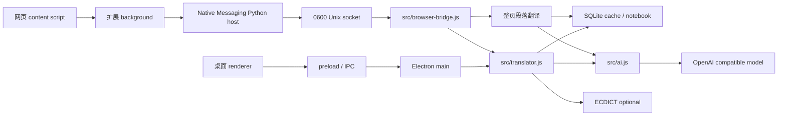

# 系统架构

版本 v0.4.5 · 2026-10-08。源码：[wordmate](../../wordmate/README.md)。

## 组件与调用链

桌面 main 管理托盘、窗口历史、服务、快捷键和 IPC。preload 只暴露必要接口，renderer 不启用 Node。扩展使用 activeTab + scripting，在用户操作后注入当前页；content script 管理段落双语 DOM、划词入口和浮层；background 管理 Chrome API 与本机连接。

Native host 读取长度前缀 JSON，向桌面的 `~/Library/Application Support/WordMate/browser.sock` 发送单行 JSON，收到响应后返回给浏览器。桌面未运行时通过 open -g 启动后台模式，不弹出查词窗。

## 浏览器协议

请求：action 为 selection 或 page；text 为 1–12000 字符；context 可选、最多 4000 字符；target 为 zh / en。返回 `{ok:true,result}` 或 `{ok:false,error}`。socket 权限为 0600，不监听外部网络；不返回 API Key。请求最多四个并发；页面最多两个段落同时翻译。45 秒模型超时、75 秒扩展请求超时。

selection 走词典 / 句子调度和生词本规则。page 强制返回译文，按目标语言、原文、接口、模型缓存，不收录到生词本。页面长段落拆分；原节点与链接保留，仅增加可移除的翻译节点。所有模型文本用 textContent 渲染。

## 数据与事务

SQLite：words、lookup_cache、settings、dictation_log、learning_events、operation_receipts、deleted_words。学习日志和评分通过事务写入；提交标识支持幂等重试；卡片 reviews 版本阻止过期评分；删除撤销保留整行学习字段。

设置和 API Key 保存在本机学习库，不进入扩展或 Git。模型服务只收到本次待翻译文本和选词上下文。

## 部署与边界

macOS Electron + Objective-C++ 服务模块需按 Electron ABI 编译。应用安装到 ~/Applications；NSServices 声明消息名、实际粘贴板 UTI、上下文及毫秒超时。Chrome / Edge / Chromium 扩展固定 ID，本机 host 注册至当前用户配置目录。

图片 OCR、视频字幕、独立 Safari 扩展和跨域 iframe 整页翻译不属于本版。真实浏览器菜单验收与程序化 DOM / socket 测试分别记录。

## v0.4.0 协议扩展

新增 get-preferences / set-preferences（仅返回 Thinking 开关和适配类型，不暴露密钥）、add-word（后台词典校验后写入生词本）。page 可传 segments 字符串数组，最多 128 项且连接后必须与 text 一致；模型返回带 id 的片段对象，后端校验并归一化为数组。

content 保存原 text node 引用和源值；双语译文在同一个原生段落内，覆盖模式写译文到原 text node。恢复仅修改仍然匹配本扩展写入值的节点，避免覆盖动态网站更新。切换模式不请求后端。

Thinking 参数由 ai.thinkingOptions 统一生成，作用于三类模型请求。auto 识别 Diffu / Qwen 与 DashScope；用户可以指定 chat_template_kwargs、enable_thinking 或 none。词典与页面缓存包括 Thinking 开关 / 适配字段，页面还包括布局片段。

参考：[Qwen vLLM Thinking 说明](https://qwen.readthedocs.io/en/stable/deployment/vllm.html)。Diffu 的具体开关已通过实际服务端 usage.reasoning_tokens 对照验证。

## 内容识别与展示策略

sourceNodes 扫描 body 的可见文本，不再只扫描第一个文章容器。isExcluded 分离硬排除、文件区域、身份标识和可点击卡片；aside / header / div / span 和排版方式不直接决定可译性。eligibleBlock 选语义段落或最近的叶级内容块，flex / grid 内容选各自单元，避免把整行合并成一个段落。

protectedText 保留原始 URL、路径、哈希和技术 / 账号标识；普通知识面板表格不是文件浏览器。insertEntry 对原生单元插入配对译文，必要时为可读叶级 flex/grid 做局部换行，对 line-clamp 文字解除截断；修改记录在 entry.layout，恢复时只还原仍由扩展控制的样式。

边界与取舍见 [ADR-002](ADR-002-内容识别与展示分离.md) 和 [翻译边界](../产品需求目录/翻译边界.md)。

## 社交正文边界与动态调度

postBody 识别明确 tweetText / postText / data-post-body 标记，或 article 中的完整 dir=auto 文本；isExcluded 区分正文内部控件和外层引用卡片。引用帖父容器可点击属性不排除正文，身份区和互动控件不参与翻译。

MutationObserver 在用户启动页面翻译后监听 documentElement 的子节点、字符和显示相关属性；滚动 / resize 触发补充检查。300ms 去抖、pageRunning 串行启动批次，批内双并发；entries 校验用于去重及虚拟节点内容变更。停止 / 恢复关闭监听调度，失败暂停自动调度。只扫描符合正文规则的内容，不扩大页面或模型权限。

## 响应恢复边界

answerText 只读取最终 content / 文本数组 / tool-call arguments，不取 reasoning_content。extractJSON 先完整解析，再去思考标签并扫描带引号保护的平衡对象，避免贪婪地拼接多个 JSON。passageResult 校验片段数量 / 编号；完整 segments 缺少冗余 translation 时重建段落译文。

translatePassage 使用自适应 max_tokens 和最多两次请求，共享一个 45 秒 AbortSignal。格式错误或 429/5xx 允许一次重试；HTTP 401 / 明确 refusal 直接失败。缓存键升级到 page-v3，避免继续使用旧解析策略的缓存。控制面板显示失败源片段，保留原文，不伪造成功结果。

## 重启 / 多副本部署

browser-host/connection.json 保存安装时的应用绝对路径，0600 权限；launcher 使用 /usr/bin/python3，不固定到 CommandLineTools 内部解释器位置。Host 遇 ENOENT / ECONNREFUSED 时关闭失败描述符，open -g -n 确切 bundle 并传 repair-browser-bridge，新建 socket 重试。

main 第二实例路径识别修复标志；repairBrowserBridge 复用并发修复 Promise，缺失监听时关闭旧连接并重新注册。生产安装脚本沿用系统 Applications 的现有路径，备份旧 bundle，同步已存在用户目录副本，避免登录项仍引用旧包。

## v0.5.0 目标架构（未实施）

新增 Rust 本地输入核心及 macOS IMK 输入组件，Electron 提供独立 IME RPC、统一云请求队列及确认后学习。基础输入不依赖后端，浏览器协议继续独立。详细状态、接口、数据迁移与恢复规则见 [输入法架构设计](v0.5.0-输入法架构设计.md) 和 [ADR-003](ADR-003-输入法与学习服务分离.md)。

## v0.5.0 输入法开发组件

新增 Rust / IMK 输入组件与 ime.sock 服务，复用模型配置与共享请求队列；已确认采用通过 ime_usage_events 和 operation_receipts 入本，不更新查词次数与复习排程。详见 [目标架构](v0.5.0-输入法架构设计.md)和 [实施记录](../测试目录/v0.5.0-实施记录.md)。当前输入源激活尚未通过，桌面仍保留 0.4.5 标识。

## 0.6.0 英文键盘

原生壳新增独立英文按键分流与软件中英模式覆盖；词库、确认学习、桥接与系统身份复用。见 [ADR-009](ADR-009-英文键盘与中文确认分流.md)。
