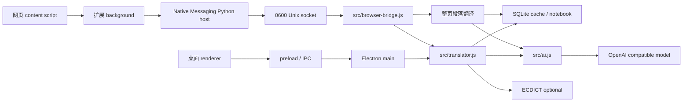

# 系统架构

版本 v0.4.1 · 2026-10-08。源码：[wordmate](../../wordmate/README.md)。

## 组件与调用链

桌面 main 管理托盘、窗口历史、服务、快捷键和 IPC。preload 只暴露必要接口，renderer 不启用 Node。扩展使用 activeTab + scripting，在用户操作后注入当前页；content script 管理段落双语 DOM、划词入口和浮层；background 管理 Chrome API 与本机连接。

Native host 读取长度前缀 JSON，向桌面的 `~/Library/Application Support/WordMate/browser.sock` 发送单行 JSON，收到响应后返回给浏览器。桌面未运行时通过 open -g 启动后台模式，不弹出查词窗。

## 浏览器协议

请求：action 为 selection 或 page；text 为 1–12000 字符；context 可选、最多 4000 字符；target 为 zh / en。返回 `{ok:true,result}` 或 `{ok:false,error}`。socket 权限为 0600，不监听外部网络；不返回 API Key。请求最多四个并发；页面最多两个段落同时翻译。45 秒模型超时、60 秒扩展请求超时。

selection 走词典 / 句子调度和生词本规则。page 强制返回译文，按目标语言、原文、接口、模型缓存，不收录到生词本。页面长段落拆分；原节点与链接保留，仅增加可移除的翻译节点。所有模型文本用 textContent 渲染。

## 数据与事务

SQLite：words、lookup_cache、settings、dictation_log、learning_events、operation_receipts、deleted_words。学习日志和评分通过事务写入；提交标识支持幂等重试；卡片 reviews 版本阻止过期评分；删除撤销保留整行学习字段。

设置和 API Key 保存在本机学习库，不进入扩展或 Git。模型服务只收到本次待翻译文本和选词上下文。

## 部署与边界

macOS Electron + Objective-C++ 服务模块需按 Electron ABI 编译。应用安装到 ~/Applications；NSServices 声明消息名、实际粘贴板 UTI、上下文及毫秒超时。Chrome / Edge / Chromium 扩展固定 ID，本机 host 注册至当前用户配置目录。

图片 OCR、视频字幕、独立 Safari 扩展和跨域 iframe 整页翻译不属于本版。真实浏览器菜单验收与程序化 DOM / socket 测试分别记录。

## v0.4.0 协议扩展

新增 get-preferences / set-preferences（仅返回 Thinking 开关和适配类型，不暴露密钥）、add-word（后台词典校验后写入生词本）。page 可传 segments 字符串数组，最多 128 项且连接后必须与 text 一致；模型返回带 id 的片段对象，后端校验并归一化为数组。

content 保存原 text node 引用和源值；双语译文在同一个原生段落内，覆盖模式写译文到原 text node。恢复仅修改仍然匹配本扩展写入值的节点，避免覆盖动态网站更新。切换模式不请求后端。

Thinking 参数由 ai.thinkingOptions 统一生成，作用于三类模型请求。auto 识别 Diffu / Qwen 与 DashScope；用户可以指定 chat_template_kwargs、enable_thinking 或 none。词典与页面缓存包括 Thinking 开关 / 适配字段，页面还包括布局片段。

参考：[Qwen vLLM Thinking 说明](https://qwen.readthedocs.io/en/stable/deployment/vllm.html)。Diffu 的具体开关已通过实际服务端 usage.reasoning_tokens 对照验证。

## 正文识别策略

readingRoots 优先 .markdown-body / article / role=article，回退 main / body。eligibleBlock 只选择语义段落并过滤导航、控件、tree / grid / row、时间与紧凑布局；不再按任意链接 / div 分组。protectedText 保护路径、哈希、日期和技术标识，同时用于片段译文写入。正文中内联链接仍归属于完整段落。
